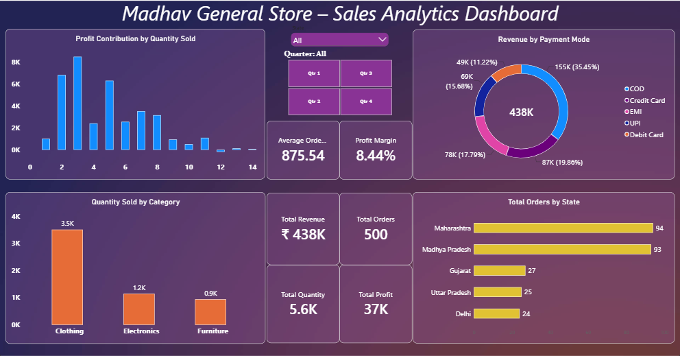

# Madhav General Store – Sales Analysis Dashboard

## Project Overview
This project presents an interactive sales analysis dashboard built using Microsoft Power BI. It explores sales performance, profitability, customer orders, product categories, payment methods, and state-wise performance.

## Dashboard Preview

## Tools & Technologies
- Microsoft Power BI Desktop
- Power Query
- DAX (Data Analysis Expressions)
- CSV datasets

## Key Performance Indicators
- **Total Revenue:** 437,771
- **Total Profit:** 36,963
- **Total Orders:** 500
- **Total Quantity Sold:** 5,615
- **Average Order Value:** 875.54
- **Profit Margin:** 8.44%

*Note: Currency is not specified in the source dataset.*

## Dashboard Features
- Revenue and profit performance analysis
- Quantity sold by product category
- Revenue distribution by payment method
- Top five states by order volume
- Interactive state and quarterly filters
- KPI cards for key business metrics

## Key Business Insights
- Electronics generated the highest revenue among the three product categories.
- Clothing generated the highest category-level profit.
- Maharashtra had the highest revenue among the states.
- Printers generated the highest revenue among the product subcategories.
- January recorded the highest monthly revenue.

## Files Included
- `Madhav_General_Store_Sales_Analysis.pbix` – Power BI report
- `Dashboard_Preview.png` – Dashboard screenshot

## How to View the Project
1. Download the `.pbix` file from this repository.
2. Open it using Microsoft Power BI Desktop.
3. Explore the dashboard using the interactive filters and visuals.

## Skills Demonstrated
- Data analysis and visualization
- Data modeling and relationships
- DAX measures
- KPI development
- Business insights and reporting

---

**Created as a data analytics portfolio project.**
